# kidney-sim · build a kidney, one equation at a time

An open-source, **incremental** model of the human kidney written in Python for
**high-school students** (ages ~15–18) and their teachers. It runs in
[Google Colab](https://colab.research.google.com), so nothing needs to be installed.

The model is built as a **sum of levels**. Each level adds one physical or
chemical idea to the previous one, so students can see *why* each piece is needed:

| Level | Notebook | Idea | Main science | Figures |
|---|---|---|---|---|
| 0 | [`00_body_tank`](notebooks/00_body_tank.ipynb) | The body is a tank; the kidney is its drain | mass balance, Euler's method | 2D |
| 1 | [`01_glomerulus_pressure`](notebooks/01_glomerulus_pressure.ipynb) | The glomerulus filters blood using **pressure** | Starling forces, flow as a circuit, autoregulation | 2D + 3D |
| 2 | [`02_tubule_transport`](notebooks/02_tubule_transport.ipynb) | The tubule takes back what we need using **membrane chemistry** | transporters, exchangers, osmosis | 2D + 3D |
| 3 | [`03_loop_of_henle_countercurrent`](notebooks/03_loop_of_henle_countercurrent.ipynb) | A hairpin tube builds a salt gradient | countercurrent multiplication | 2D + 3D |
| 4 | [`04_whole_body_feedback`](notebooks/04_whole_body_feedback.ipynb) | Kidney + body + hormones | negative feedback (ADH, thirst, aldosterone) | 2D |
| 5 | [`05_artificial_kidney`](notebooks/05_artificial_kidney.ipynb) | Dialysis machine | diffusion membranes + **ion exchange** | 2D + 3D |
| ▶ | [`06_video`](notebooks/06_video.ipynb) | Animated video: blood in → filtration → cleaning → urine out | all levels together | video |

> **Two kinds of process.** In the kidney, the *physical* part (Level 1) is
> filtration driven by **blood pressure**. The *chemical* part (Level 2) is
> **membrane transport**: pumps, co-transporters, channels and **exchangers** (for
> example Na⁺/H⁺, and OAT1, which swaps one molecule for a toxin or drug). True
> ion exchange of the "resin" type appears in Level 5: the sorbent cartridge of
> an artificial kidney.

> **Common misconception.** The kidney does **not** produce urea. The **liver**
> makes urea from the nitrogen of proteins; the kidney **removes** it into the
> urine (water + urea + salts + other wastes).

## Video: from blood to urine

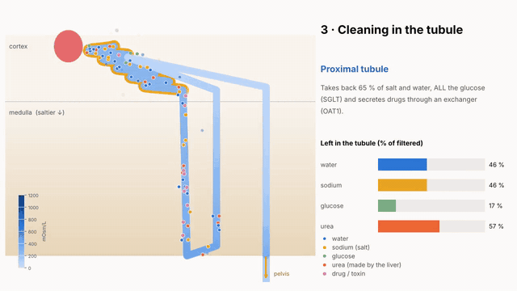

An 80-second animation of the whole process:

1. blood enters the kidney;
2. it is filtered in the glomerulus;
3. the tubule cleans it;
4. urine travels to the bladder and leaves the body.

**Download:** [English](docs/video/kidney_video_en.mp4) · [Español](docs/video/kidney_video_es.mp4)

The video is a **simulation, not a cartoon**:

- particles filter where the net filtration pressure is highest (Level 1);
- each particle is reabsorbed along the nephron with the probability the tubule model gives for its substance (Level 2);
- the model's urine flow fills the bladder.

Change the model and render the video again:

```python
from kidneysim.animation import make_video
make_video("no_adh.mp4", lang="en", nephron_kwargs={"ADH": 0.0})   # needs ffmpeg (Colab has it)
```

---

## Quick start

**In Colab (recommended).** Open any notebook from the table above with the
*Open in Colab* badge at the top of the notebook and run the first cell. It
downloads this repository and imports the package. Sliders (ipywidgets) and
interactive 3D (plotly) are already installed in Colab.

**On your computer:**

```bash
git clone https://github.com/YOUR-USERNAME/kidney-sim.git
cd kidney-sim
pip install -r requirements.txt
jupyter notebook notebooks/
```

**From Python:**

```python
import kidneysim as ks
r = ks.tubule.run_nephron(ADH=1.0)          # maximum ADH: concentrated urine
print(ks.tubule.summary(r))
ks.viz3d.nephron_3d(r, quantity="osm").show()
```

> After you publish the repository, replace `YOUR-USERNAME` in
> `tools/build_notebooks.py` and run `python tools/build_notebooks.py` so the
> Colab badges and the setup cell point to your GitHub account.

---

## Repository layout

```
kidney-sim/
├── kidneysim/                 the Python package (all equations live here)
│   ├── constants.py           normal values for a healthy adult
│   ├── body.py                Level 0  one-compartment body
│   ├── glomerulus.py          Level 1  pressure-driven filtration
│   ├── tubule.py              Level 2  membrane transport along the nephron
│   ├── countercurrent.py      Level 3  loop of Henle box model
│   ├── coupled.py             Level 4  body + kidney + hormones
│   ├── dialysis.py            Level 5  dialyzer + ion-exchange sorbent
│   ├── geometry.py            shapes used only for drawing (nephron, glomerulus, fibres)
│   ├── viz2d.py               2D figures (matplotlib)
│   ├── viz3d.py               3D figures (plotly interactive or matplotlib)
│   ├── animation.py           the video (scenes drawn from the model, encoded with ffmpeg)
│   └── ui.py                  sliders helper (works with or without ipywidgets)
├── notebooks/                 one Colab notebook per level
├── docs/teacher_guide.md      lesson plans, misconceptions, assessment ideas
├── docs/img/                  figures used in this README
├── docs/video/                rendered videos (English, Spanish) and a GIF preview
├── tests/test_physiology.py   checks the model against textbook values
└── tools/                     scripts that build the notebooks and figures
```

Units everywhere: pressure **mmHg**, flow **L/min** (shown as mL/min),
concentration **mmol/L**, osmolarity **mOsm/L**, time **min** (days for the body).

---

## Level 0 · The body as a tank

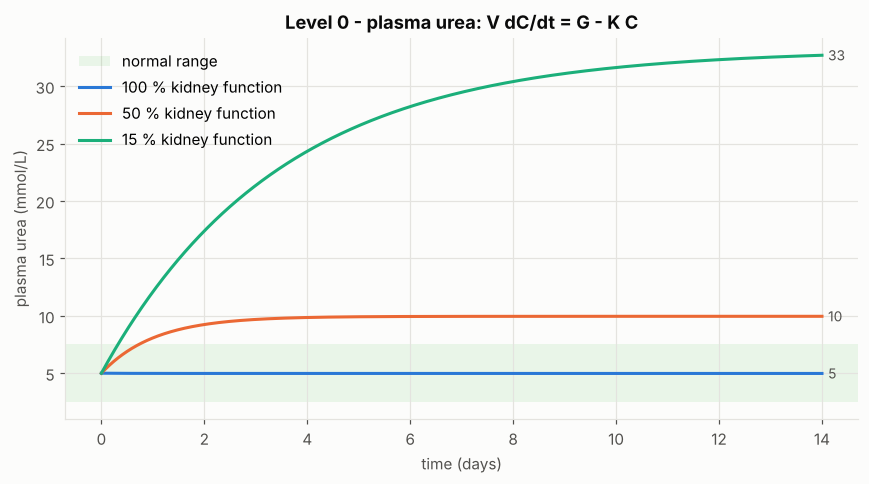

**Idea.** All body water (≈ 42 L) is one well-mixed tank. The liver adds urea;
the kidneys remove it.

**Governing equation (mass balance).**

$$V\,\frac{dC}{dt} = G - K\,C$$

| symbol | meaning | value |
|---|---|---|
| $C$ | plasma concentration | urea 5 mmol/L |
| $V$ | distribution volume (body water) | 42 L |
| $G$ | generation rate | urea 0.28 mmol/min (≈ 400 mmol/day) |
| $K$ | **clearance**: plasma volume completely cleaned per minute | urea ≈ 0.45 × GFR ≈ 56 mL/min |

**Consequences.** Steady state $C_{ss} = G/K$ (halve the kidney → double the urea).
Time constant $\tau = V/K$ (≈ 12 h for urea, so changes take days).

**Numerics (Euler's method).**
$C(t+\Delta t) = C(t) + \Delta t\,\big(G - K\,C(t)\big)/V$

Code: [`kidneysim/body.py`](kidneysim/body.py)

---

## Level 1 · Glomerulus: filtration driven by pressure

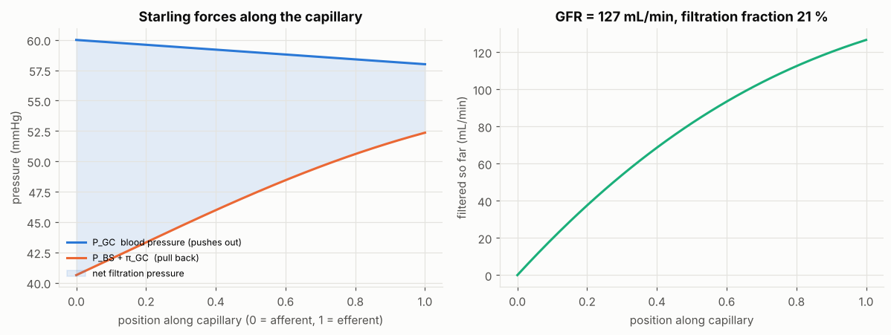

**Blood flow as an electric circuit.** The afferent (in) and efferent (out)
arterioles are two resistances in series:

$$Q_{blood} = \frac{MAP - P_{vein}}{R_a + R_e},\qquad P_{GC} = MAP - Q_{blood}\,R_a$$

The narrow efferent arteriole keeps the glomerular pressure high (≈ 60 mmHg,
about twice that of other capillaries).

**Starling equation along the capillary** ($x$ from 0 to 1):

$$\frac{dQ_f}{dx} = K_f\Big[(P_{GC} - P_{BS}) - (\pi_{GC} - \pi_{BS})\Big]$$

- $P_{GC}$: blood pressure in the capillary (pushes water out)
- $P_{BS}$: pressure in Bowman's space (15 mmHg, pushes back)
- $\pi_{GC}$: oncotic pressure of plasma proteins (pulls water back)
- $K_f$: filtration coefficient = water permeability × area (0.0105 L/min/mmHg)

Proteins stay in the blood, so they become more concentrated as water leaves:

$$c(x) = c_0\,\frac{Q_p(0)}{Q_p(x)},\qquad \pi(c) = 2.1\,c + 0.16\,c^2 + 0.009\,c^3\quad(\text{Landis–Pappenheimer},\ c \text{ in g/dL})$$

$$\text{GFR} = \int_0^1 \frac{dQ_f}{dx}\,dx \approx 125\ \text{mL/min} \;(180\ \text{L/day})$$

**Autoregulation (myogenic response).** The afferent arteriole adjusts so
that blood flow stays constant between ≈ 80 and 180 mmHg:

$$R_a = \frac{MAP - P_{vein}}{Q_{target}} - R_e,\qquad 0.5\,R_{a,0} \le R_a \le 3\,R_{a,0}$$

**Sieving (who passes the filter).** For a molecule of radius $r$ and pore radius $r_p$ (4.5 nm):

$$\lambda = r/r_p,\qquad \theta = (1-\lambda)^2\,\big(2-(1-\lambda)^2\big)$$

Negatively charged albumin gets an extra penalty (× 0.05) because the filter is also negatively charged.

| 3D: capillary loops coloured by net filtration pressure | 3D: GFR vs blood pressure and filter health |
|---|---|
| 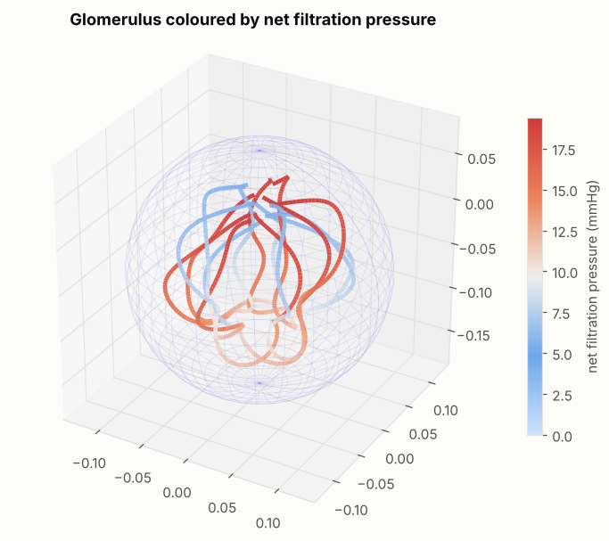 | 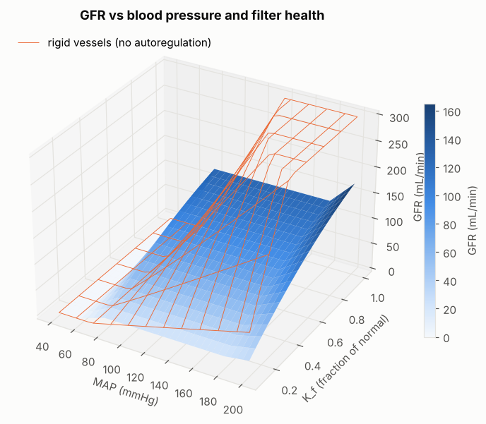 |

Code: [`kidneysim/glomerulus.py`](kidneysim/glomerulus.py)

---

## Level 2 · Tubule: membrane transport (the chemistry)

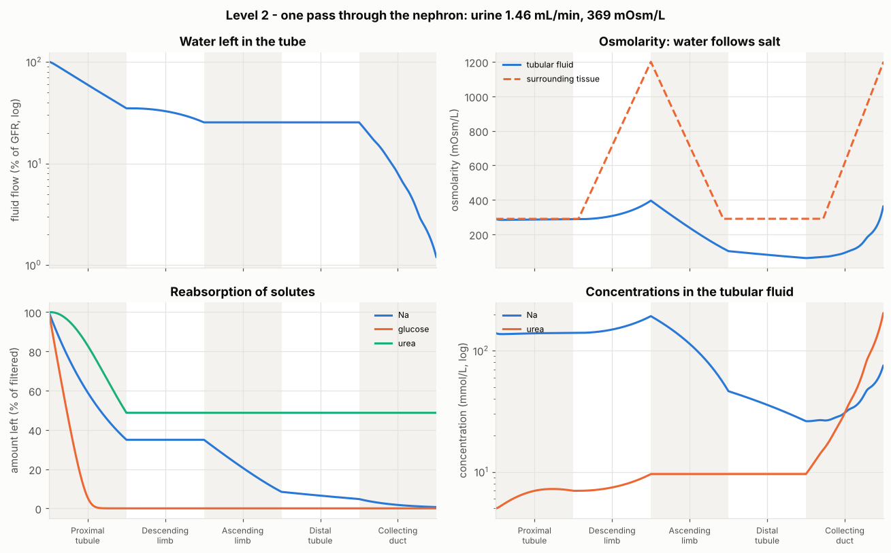

We follow the filtrate along five segments. One "average" nephron is scaled to
represent all ≈ 2 million nephrons. State along the tube (position $s$ in each segment):
water flow $F$ (L/min) and solute flows $N_i = F\,C_i$ (mmol/min).

$$Osm_{lumen} = \frac{2N_{Na} + N_{glucose} + N_{urea} + N_{drug}}{F}\qquad(\text{NaCl gives 2 particles})$$

| process | equation | where / example |
|---|---|---|
| saturable transporter (Michaelis–Menten) | $\dfrac{dN_i}{ds} = -J_{max}\dfrac{C_i}{K_m + C_i}$ | glucose by SGLT (PT), NaCl by NKCC2 (AL) and NCC (DCT) |
| proportional ("leaky") reabsorption | $\dfrac{dN_i}{ds} = -k\,N_i$ | Na in PT (≈ 65 %); Na in CD, $k = k_0 + k_A\cdot\text{aldosterone}$ |
| diffusion (Fick) | $\dfrac{dN_u}{ds} = -P_u\,(C_{u,lumen} - C_{u,plasma})$ | urea in PT |
| secretion by an **exchanger** | $\dfrac{dN_d}{ds} = +S_{max}\dfrac{C_{d,plasma}}{K_m + C_{d,plasma}}$, limited by plasma supply | drugs and toxins via OAT1 (α-ketoglutarate ⇄ organic anion) |
| osmosis (water follows solutes) | $\dfrac{dF}{ds} = -L_p\,(Osm_{tissue} - Osm_{lumen})$ | high $L_p$ in PT and DL, zero in AL and DCT |
| ADH control of water channels | $L_p = L_{p0}\,(L_{p,max}/L_{p0})^{ADH}$ | collecting duct (aquaporin-2) |

**Tissue (interstitium) osmolarity:** 290 mOsm/L in the cortex, rising
linearly through the medulla up to $Osm_{max}$ ≈ 1200 mOsm/L at the papilla. The
gradient is built by Level 3.

**Segments.**

| segment | what it does | drug that blocks it |
|---|---|---|
| PT proximal tubule | ≈ 65 % of Na and water back, all glucose, ≈ 50 % urea, secretes drugs | SGLT2 inhibitors (glucose) |
| DL descending limb | water leaves (salt stays) | – |
| AL ascending limb | salt pumped out, water cannot follow → dilute fluid | furosemide (NKCC2) |
| DCT distal tubule | a little more salt out | thiazides (NCC) |
| CD collecting duct | final salt (aldosterone) and water (ADH) adjustment | – |

**Numerics.** Euler steps along $s$ for solutes. The water step uses a backward
(implicit) Euler step, solved exactly as a quadratic, so the flow can never become negative:

$$F_{new} = \tfrac12\Big(b + \sqrt{b^2 + 4\,L_p\Delta s\,N_{osm}}\Big),\qquad b = F - L_p\,\Delta s\,Osm_{tissue}$$

The collecting duct is split into 5 parallel ducts with different
permeabilities (× 0.15 … × 2.4), because real ducts are not identical. This
makes the response to ADH gradual.

| 3D nephron coloured by osmolarity (grey wall = tissue osmolarity) | glucose titration curve |
|---|---|
| 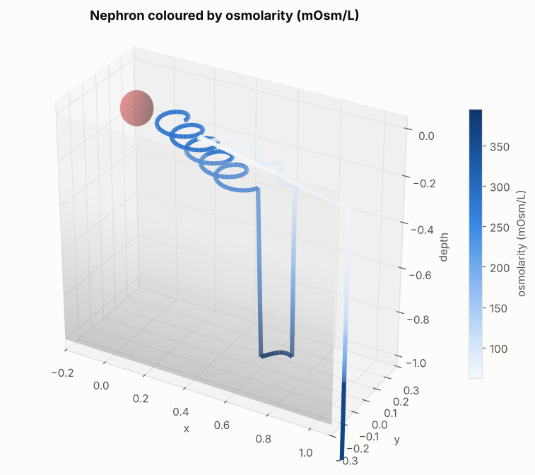 | 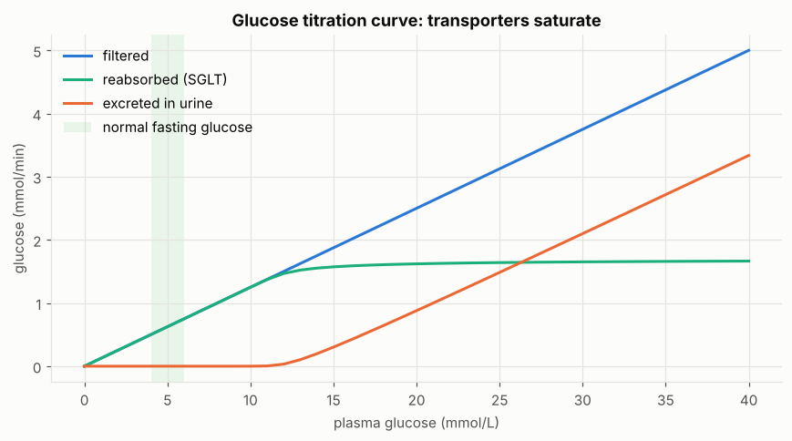 |

Code: [`kidneysim/tubule.py`](kidneysim/tubule.py)

---

## Level 3 · Loop of Henle: countercurrent multiplier

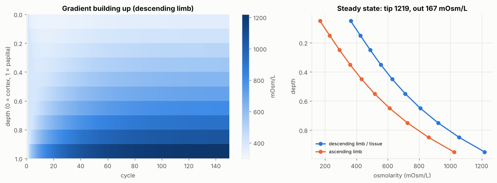

Box model with $n$ levels. $D_i$ is the descending limb (equal to the tissue)
and $A_i$ the ascending limb. Each cycle:

1. **Single effect (pumps).** $m_i = \tfrac12(D_i + A_i)$, $\;D_i = m_i + \tfrac{\delta}{2}$, $\;A_i = m_i - \tfrac{\delta}{2}$ with $\delta \approx 200$ mOsm/L.
2. **Washout by blood (vasa recta).** $D_i \leftarrow D_i - w\,(D_i - 300)$, and the same for $A_i$, with $w = 0.02$.
3. **Flow.** Shift one box around the hairpin. Fresh fluid at 300 mOsm/L enters the top of $D$; the top of $A$ leaves, diluted (≈ 170 mOsm/L).

A difference of only 200 mOsm/L between neighbouring tubes is multiplied along the
loop into a 300 → 1200 mOsm/L gradient. Longer loops give higher tips, which is
why desert animals have long loops. The tip value is the $Osm_{max}$ used in Level 2.

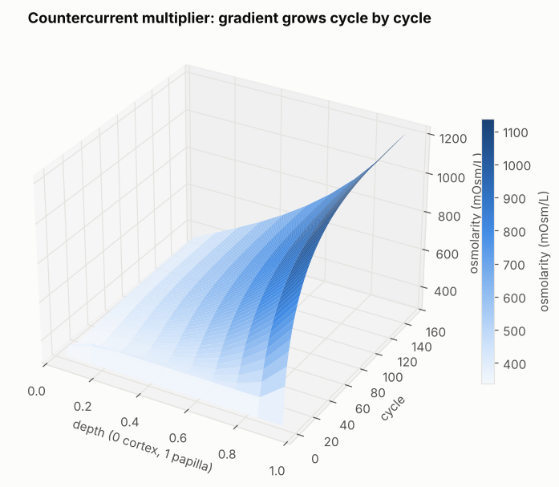

Code: [`kidneysim/countercurrent.py`](kidneysim/countercurrent.py)

---

## Level 4 · Kidney + body + hormones (homeostasis)

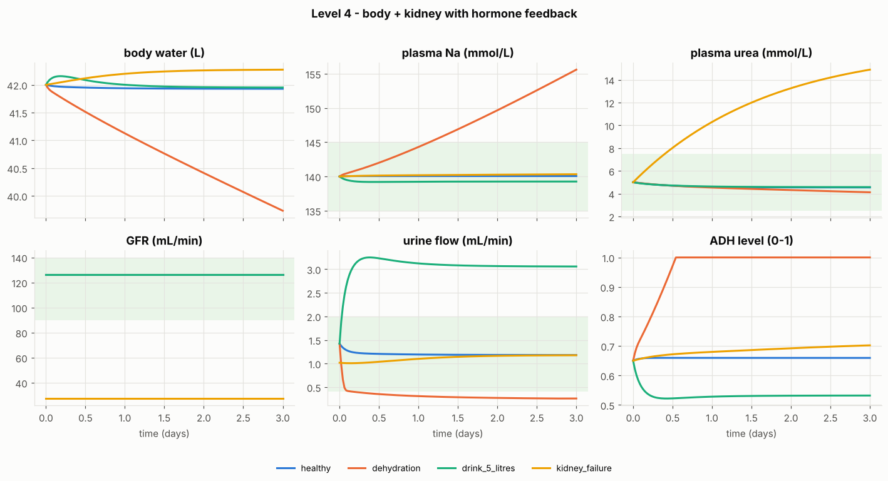

**State:** body water $V$, salt osmoles $S$, urea $U$ and creatinine $Cr$.
Plasma: $P_{Na} = S/2V$; tonicity $= S/V + \text{glucose}$ (urea crosses cell
membranes freely, so it does not count).

**Balances:**

$$\frac{dV}{dt} = \text{intake} + \text{thirst} - \text{urine} - \text{insensible loss}$$

$$\frac{dS}{dt} = 2\,(\text{salt intake} - \text{Na excreted}),\qquad \frac{dU}{dt} = G_{urea} - \text{urea excreted},\qquad \frac{dCr}{dt} = G_{Cr} - \text{GFR}\cdot P_{Cr}$$

**Feedback loops:**

$$ADH = \text{clip}\big(0.65 + 0.08\,(\text{tonicity} - 285),\ 0,\ 1\big)$$

$$\text{thirst} = \text{clip}\big(0.5\,(\text{tonicity} - 287),\ 0,\ 10\big)\ \text{L/day}$$

$$\text{aldosterone} = \text{clip}\Big(1 + 30\,\frac{V_0 - V}{V_0} + 0.05\,(100 - MAP),\ 0,\ 3\Big)$$

$$MAP = MAP_{set}\,\big(1 + 2\,(V - V_0)/V_0\big)$$

Every 30 min: compute plasma values and hormones → GFR (Level 1) → nephron (Level 2, gradient from Level 3) → Euler update of the body.
Ready-made scenarios: `healthy`, `dehydration`, `drink_5_litres`, `salty_diet`,
`diabetes`, `kidney_failure`, `low_pressure`, `furosemide`.

Code: [`kidneysim/coupled.py`](kidneysim/coupled.py)

---

## Level 5 · Artificial kidney: membranes + ion exchange

**5a. Hemodialyzer (countercurrent diffusion).**

$$Q_b\frac{dC_b}{dx} = -K_oA\,(C_b - C_d),\qquad Q_d\frac{dC_d}{dx} = -K_oA\,(C_b - C_d),\qquad C_b(0) = C_{in},\ C_d(1) = 0$$

Analytic solution (Michaels):

$$Z = \frac{Q_b}{Q_d},\quad NTU = \frac{K_oA}{Q_b},\quad E = \frac{1 - e^{NTU(1-Z)}}{Z - e^{NTU(1-Z)}},\quad K_D = E\,Q_b$$

Ultrafiltration (pressure-driven, like the glomerulus): $Q_{uf} = K_{uf}\cdot TMP$.

**5b. The patient** (Level 0 with a machine):
$\dfrac{d(VC)}{dt} = G - (K_D + K_{res})\,C$, $\;\dfrac{dV}{dt} = -Q_{uf}$.
Dose: $Kt/V \ge 1.2$, urea reduction ratio $URR = 1 - C_{end}/C_{start} \ge 65\%$.

**5c. Sorbent cartridge: real ion exchange.**

$$\text{urea} + H_2O \xrightarrow{\text{urease}} 2\,NH_4^+ + CO_3^{2-},\qquad \text{ZrP–Na} + NH_4^+ \rightleftharpoons \text{ZrP–NH}_4 + Na^+$$

$$\varepsilon\frac{\partial c}{\partial t} + u\frac{\partial c}{\partial z} = -\rho_b\frac{\partial q}{\partial t},\qquad \frac{\partial q}{\partial t} = k\,\big(q_{eq}(c) - q\big),\qquad q_{eq} = \frac{q_{max}K c}{1 + K c}\ (\text{Langmuir})$$

Solved with an upwind finite-difference scheme. For every NH₄⁺ captured, one Na⁺ is released.
When the resin is saturated, NH₄⁺ *breaks through* at the outlet.

| dialyzer profile | treatment (3×/week) |
|---|---|
| 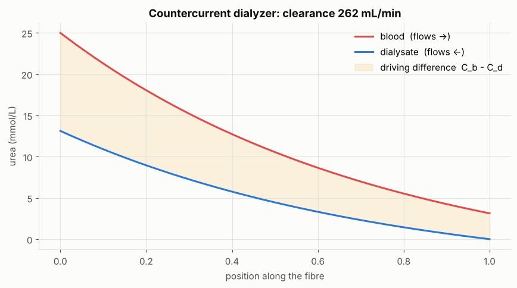 | 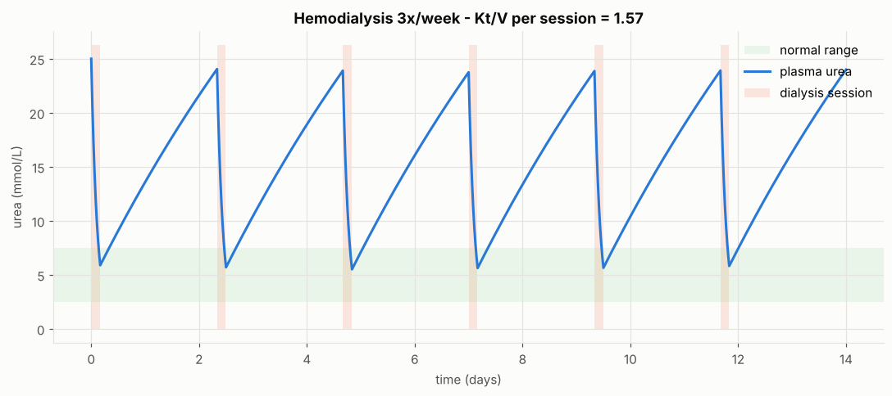 |

| breakthrough curve and resin loading | 3D: NH₄⁺ in the column vs position and time |
|---|---|
| 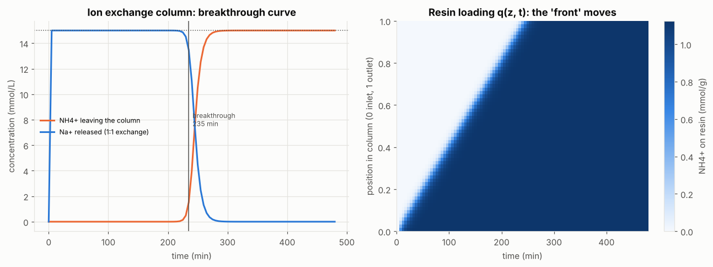 | 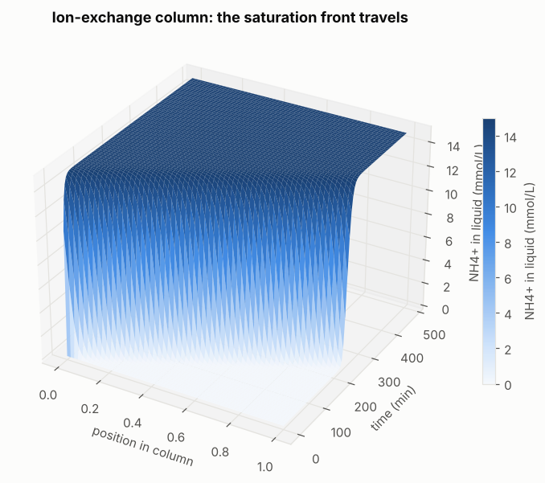 |

Code: [`kidneysim/dialysis.py`](kidneysim/dialysis.py)

---

## Does the model behave like a real kidney?

`python tests/test_physiology.py` checks these values automatically.

| quantity | model | typical textbook value |
|---|---|---|
| GFR | 127 mL/min | 90–140 mL/min |
| filtration fraction | 21 % | ≈ 20 % |
| Na reabsorbed in proximal tubule | 65 % | 60–70 % |
| urine flow (normal ADH) | 1.5 mL/min | 0.5–2 mL/min |
| urine range, ADH 0 → 1 | 17 → 0.45 mL/min | ≈ 15–20 → 0.4 mL/min |
| urine osmolarity range | 31 → 1196 mOsm/L | 50 → 1200 mOsm/L |
| fractional excretion of Na | 0.6 % | < 1 % |
| fractional excretion of urea | 49 % | 40–60 % |
| glucose appears in urine above | ≈ 12 mmol/L | ≈ 10–11 mmol/L |
| clearance of a secreted drug (PAH-like) | 567 mL/min | ≈ renal plasma flow (≈ 600) |
| loop of Henle tip | ≈ 1220 mOsm/L | ≈ 1200 mOsm/L |
| dialyzer clearance (Qb 300, Qd 500, KoA 1000) | 262 mL/min | ≈ 250 mL/min for a typical high-efficiency dialyzer |
| Kt/V for a 4 h session | 1.57 | target ≥ 1.2 |

## Simplifications (good topics for student projects)

- One average nephron represents all of them; real nephrons differ (short vs long loops).
- The medullary gradient is prescribed (linear) in Level 2; urea recycling is not modelled.
- Hormone responses are simple straight lines clipped between limits.
- K⁺, acid–base balance (H⁺, HCO₃⁻), Ca²⁺ and phosphate are not included yet.
- The pore model under-estimates the sieving of medium molecules such as inulin (real ≈ 1).
- Parameters were tuned to textbook averages, not fitted to patient data. **Not for clinical use.**

Ideas for the next levels: potassium and the Na⁺/K⁺ pump; acid–base balance with the Na⁺/H⁺ exchanger;
erythropoietin and anaemia; a 2D tissue model of the medulla; peritoneal dialysis.

## For teachers

See [`docs/teacher_guide.md`](docs/teacher_guide.md) for lesson plans (≈ 1 hour per level),
learning goals, common misconceptions and assessment ideas.

## References

- Layton, A. T. & Edwards, A. *Mathematical Modeling in Renal Physiology*. Springer, 2014.
- Hall, J. E. *Guyton and Hall Textbook of Medical Physiology*, renal chapters.
- Michaels, A. S. "Operating parameters and performance criteria for hemodialyzers and other membrane-separation devices." *Trans. ASAIO* 12 (1966).
- Deen, W. M., Robertson, C. R. & Brenner, B. M. "A model of glomerular ultrafiltration in the rat." *Am. J. Physiol.* 223 (1972).
- Weinstein, A. M. — mathematical models of tubular epithelia (many papers, *Am. J. Physiol. Renal*).

## Contributing

Issues and pull requests are welcome: new levels, translations (Catalan, Spanish…), exercises, bug fixes.
Please keep the style: one idea per level, the equation written next to the code, and a test for every new number.
To edit the notebooks, change `tools/build_notebooks.py` and run it (or edit the `.ipynb` directly).

## License

Code: MIT (see [`LICENSE`](LICENSE)). Text and figures: CC BY 4.0.
